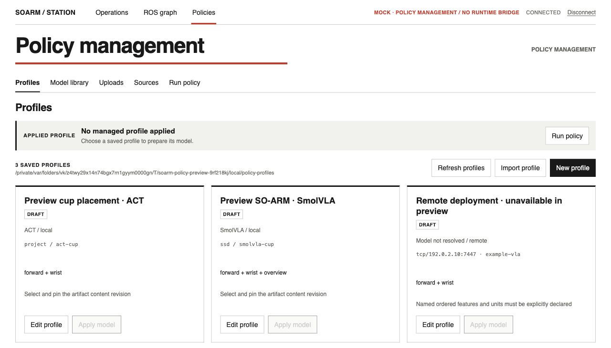
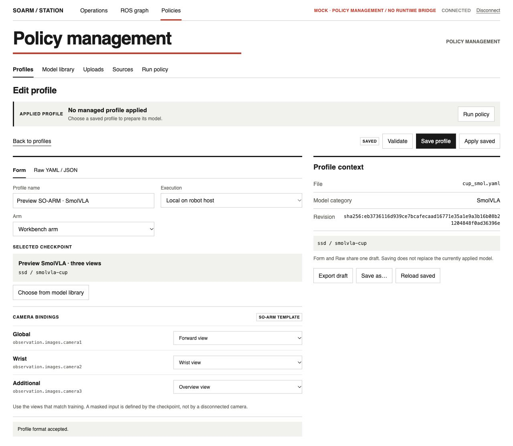
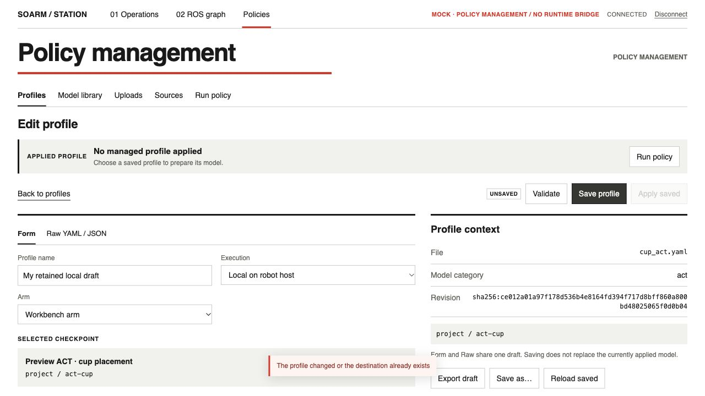

# Policy management visual and interaction QA

The third workspace extends the existing Operations and ROS graph shell. It follows the approved policy-management studio design: Helvetica typography, white and black rectangular surfaces, thin gray rules, a short red title underline, inverted selected rows and restrained status labels. The shared shell keeps its existing navigation and title scale; view names appear beneath the policy tabs.

## Observed visual checks

Desktop checks at 1280 and 1440 pixels showed readable profile cards, a two-column editor and library, full-width search across folder groups, and wrapped long revisions/paths without page overflow. The approved and integrated library screenshots were compared directly. Model/category labels were standardized to ACT, SmolVLA and π0.5. The existing Manual panel and graph retain their components and styling.

The browser viewport override did not actually produce the requested narrow width in this session. Mobile rendering is therefore not claimed as visually verified. Responsive stacking rules remain in the stylesheet.

## Interaction checks

The isolated loopback preview uses the real metadata/profile/upload backend and temporary fixtures, with no native robot bridge. Browser checks verified:

- Save/Discard/Cancel when leaving a dirty editor; Cancel retains the exact draft, Discard restores the saved document, and Save completes before navigation.
- Invalid YAML and failed saving keep the editor open. Ctrl/Cmd+S saves through the same path.
- An external profile-file modification produces a revision conflict while retaining local edits. Save as a copy succeeds.
- Model selection pins the catalog artifact revision. Form and raw editing preserve one draft.
- A five-file, approximately 4.2 MB disposable checkpoint folder completed actual chunked upload, publication and cataloging.
- Apply without a native bridge reports unavailable; it does not simulate preparation or motion.
- Manual keyboard commands remain inactive while Policies is selected. Returning to Operations showed control disabled and no active operation.

An intermediate parse error while the module was being edited was corrected before final checks. The final module passed syntax checks and loaded successfully in a fresh preview tab. Unit regressions cover asynchronous save/draft changes, exact profile/revision/arm selection, delayed preparation results, bounded upload transport and owned-operation controls. These checks do not demonstrate physical policy performance.
